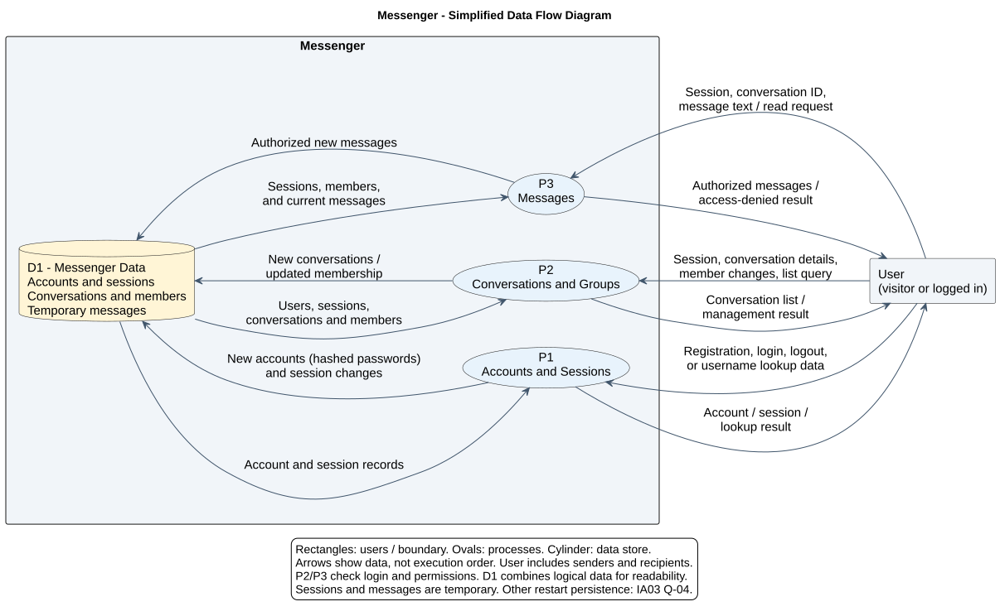
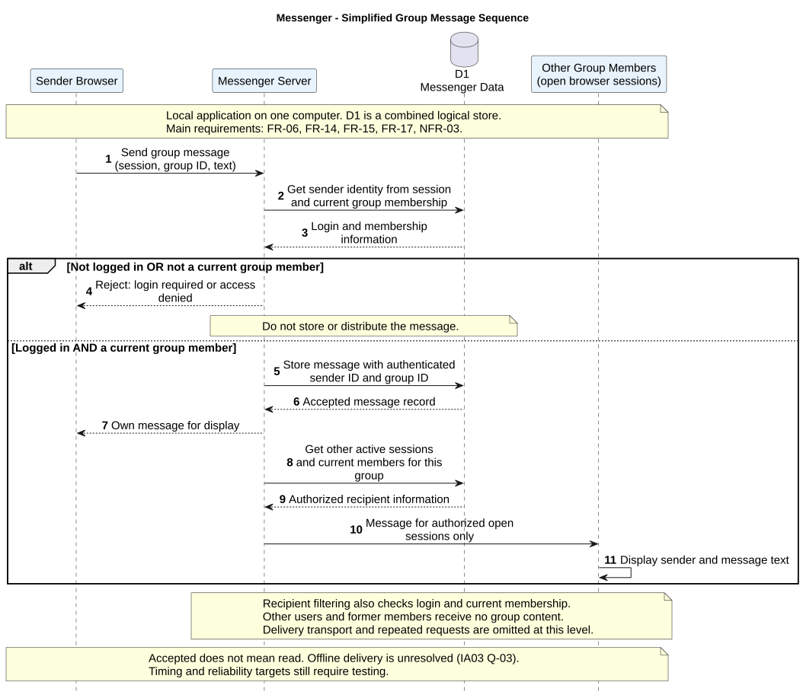

# Messenger — Diagrams and Analysis

- Course: CPS 490 — Capstone I

- Assignment: IA 04 — Messenger: Diagrams and Analysis

## 1. Introduction

#### 1.1 Purpose

This document uses a data flow diagram and a sequence diagram to examine how Messenger handles information and user actions.

The data flow diagram focuses on where data comes from, how it is processed, and where it is stored or sent.

The sequence diagram focuses on the order of interactions when a user sends a group message, including what happens when access is denied.

#### 1.2 System Scope

The diagrams describe the local first version of Messenger defined in the statement of work and requirements document.

- The application runs on one computer with a local server and separate browser sessions for different users.

- Required features include registration, login, logout, user lookup, private text messaging, basic group management, and group text messaging.

- Only authorized participants can read or send messages in a conversation.

- Public hosting and access from other computers are outside the first-version scope.

- Message history across login sessions and message search remain optional and are not included in these models.

#### 1.3 Related Documents and Diagram Sources

- [Statement of Work](statement-of-work.md)

- [Requirements](requirements.md)

- [Data Flow Diagram Source](diagrams/data-flow.puml)

- [Sequence Diagram Source](diagrams/sequence.puml)

The PlantUML files are the authoritative diagram sources. Any diagram images will be generated from these files.

The analysis will use requirement identifiers from the requirements document to explain which behaviors each model represents.

## 2. Data Flow Diagram Analysis

#### 2.1 Engineering Question

Where does Messenger receive information, how does it process that information, and what data does it need to keep so that users can communicate?

The diagram shows three internal processes rather than only showing Messenger as one box.
It focuses on data movement, not the order of button clicks.

#### 2.2 Main Model Elements

The external entity is User. This represents visitors, logged-in users, senders, recipients, and group creators.
Each action still requires the appropriate permissions.

The model uses three processes:

- P1 — Accounts and Sessions: Handles registration, login, logout, and user lookup.

- P2 — Conversations and Groups: Creates private conversations and groups, updates memberships, and provides conversation lists.

- P3 — Messages: Checks conversation access, accepts messages, and provides messages to authorized participants.

D1 — Messenger Data combines four kinds of information in one logical store:

- Accounts, including user identifiers, usernames, and salted password hashes.

- Active sessions that connect logged-in sessions to user accounts.

- Conversations, group names, private participants, and current group memberships.

- Temporary message text, sender identifiers, and conversation identifiers.

The combined store keeps the diagram readable. It does not require all data to use the same table, storage technology, or retention period.

The arrows show information exchanged with each process. They do not show execution order. Users never access the store directly.

#### 2.3 Related Requirements

- FR-01 through FR-07 relate to account access, sessions, and user lookup.

- FR-08, FR-12, FR-13, FR-16, and FR-18 relate to conversation creation, group membership, and conversation lists.

- FR-09 through FR-11, FR-14, FR-15, FR-17, and FR-19 relate to reading and sending messages in authorized conversations.

- NFR-02 relates to protecting stored passwords.

- NFR-03 relates to checking login status and conversation membership whenever messages are read or sent.

The diagram represents these responsibilities and their data needs.
It does not prove that performance or reliability targets have been met.

#### 2.4 Responsibilities and Dependencies

The messaging process needs both session information and conversation membership information.

A valid login does not give a user permission to access every conversation.
The system must also check whether the user belongs to the requested conversation.

Membership changes must affect later message requests. For example, after a user leaves a group,
the messaging process must use the updated membership information and reject further access.

Account passwords must be converted to salted hashes before they are stored.
The account data in D1 must not contain readable passwords.

Users interact with system processes rather than reading or changing data stores directly.

#### 2.5 Questions Revealed by the Model

The model highlights a difference between conversation information and message history.

Even when old messages are not required, Messenger still needs to know which conversations exist and who belongs to them.
Making message history optional does not remove the need for account and membership data.

This makes Q-04 in the requirements document important: which data must remain available after the server restarts?

For this model:

- Active sessions and temporary message data are treated as temporary runtime data.

- Restart behavior for accounts, conversations, and memberships remains unresolved.

- A data store in the diagram does not automatically mean that its contents survive a restart.

Before implementation, the restart behavior must be decided and recorded in the requirements.
Any new requirement must also receive an acceptance check.

#### 2.6 Diagram Source

The diagram source is stored in [data-flow.puml](diagrams/data-flow.puml).

## 3. Sequence Diagram Analysis

#### 3.1 Engineering Question

When a user sends a group message, which parts of Messenger interact, in what order, and what happens if the user is not allowed to send it?

The sequence diagram follows one group-message request. One alternative block separates rejection from successful processing.
Rejection covers both an invalid login session and missing group membership.

#### 3.2 Scenario and Participants

For successful delivery, the sender is logged in and is a current group member.
Recipients must also have active sessions, current membership, and an open group conversation.

The simplified diagram has four participants:

- Sender Browser: Submits the group identifier and message text using the current session.

- Messenger Server: Checks access, records accepted messages, and selects authorized recipients.

- D1 — Messenger Data: Supplies session and membership information and holds accepted messages.
It is the same combined logical store used in the data flow diagram.

- Other Group Members: Represents the other open browser sessions that are authorized to receive the message.

All participants run on the same computer. The diagram does not imply separate servers or a public deployment.

#### 3.3 Successful Interaction

- The sender submits a text message for a selected group.

- The server checks whether the login session is valid and identifies the sender from that session.

- The server checks whether the sender is a current member of the selected group.

- After both checks pass, the server records the message with its sender and group identifiers.

- The server makes the message available to authorized group members with active, open conversations, including the sender.

- The browser sessions display the message with the correct sender and text.

Recipient access must also be checked. The server uses session and membership records to select authorized recipients.
Permission to send a message does not give every connected user permission to receive it.
Repeated requests and delivery transport are omitted to keep the model focused on responsibilities.

#### 3.4 Alternative and Failure Paths

- Invalid Session: If the session is missing, expired, or ended by logout, the server rejects the request.
It does not store or distribute the submitted message.

- Not a Group Member: If the session is valid but the sender is not a current group member, the server rejects the request.
This includes a user who has left the group but still has an old group page open.

- Unauthorized Recipient: A connected user who is not a current group member must not receive the group message.

The access checks happen before an unauthorized request can change message data or expose group content.

#### 3.5 Related Requirements

- FR-05 and FR-06 explain why a logged-out session cannot send messages.

- FR-14 describes sending text messages as a current group member.

- FR-15 describes displaying group messages to current members with the conversation open.

- FR-16 and FR-17 explain why leaving a group removes access to later group-message requests.

- NFR-03 requires server-side checks for login status and conversation membership.

- NFR-04 relates to displaying messages with the correct sender and unchanged text, without duplication during the defined test.

The diagram shows the interaction needed to support these requirements. Actual timing and delivery results still require testing.

#### 3.6 Responsibilities and Open Questions

The server must identify the sender from the authenticated session.
It must not trust a sender name supplied in the message request as proof of identity.

The sequence also shows why a check made only when the group page opens is insufficient. 
A user may log out or leave the group before sending another message.

A remaining question is what happens if a recipient disconnects after a message has been accepted but before it is displayed. 
This is a specific case of Q-03 in the requirements document.

Accepting a message on the server does not prove that every recipient has received or read it.
The current requirements do not promise offline delivery, automatic retries, or read receipts.

Any decision to add those behaviors must be recorded in the requirements and acceptance criteria before being treated as required functionality.

#### 3.7 Diagram Source

The diagram source is stored in [sequence.puml](diagrams/sequence.puml).

The diagram below shows the steps for sending a group message and the checks used to prevent unauthorized access.

## 4. Consistency and Traceability

#### 4.1 Different Views of the Same System

The two diagrams describe the same local Messenger application, but answer different questions.

- The data flow diagram shows what information moves between users, processes, and the data store.

- The sequence diagram shows the order of interactions for sending a group message, including rejection when access is not allowed.

Both diagrams use D1 — Messenger Data to represent accounts, sessions, conversations, memberships, and temporary messages.
Combining these details in one logical store simplifies the presentation without changing the required features.

#### 4.2 Requirement Coverage

| Model Area | Related Requirements | What the Model Shows |
| --- | --- | --- |
| DFD: Accounts and Sessions | FR-01 through FR-07, NFR-02 | Account inputs, login sessions, user lookup, and protected password storage. |
| DFD: Conversations and Groups | FR-08, FR-12, FR-13, FR-16, FR-18 | Conversation creation, group membership changes, and conversation lists. |
| DFD: Messages | FR-09 through FR-11, FR-14, FR-15, FR-17, FR-19, NFR-03 | Message inputs, stored message data, and access-controlled outputs. |
| Sequence: Sender Access | FR-06, FR-14, FR-17, NFR-03 | Checking login and current membership before accepting a message. |
| Sequence: Message Delivery | FR-15, FR-17, NFR-03 | Making messages available only to authorized recipient sessions. |

The sequence diagram shows one scenario rather than every Messenger feature.
Performance, reliability, and usability targets still need to be checked through the acceptance tests in the requirements document.

#### 4.3 Open Issues and Follow-up

- Q-03 — Disconnected Recipients: The sequence diagram shows that accepting a message is different from delivering it. Behavior after a recipient disconnects still needs a decision.

- Q-04 — Restart Behavior: The data flow diagram shows that account and membership information is separate from message history.
Which information survives a server restart still needs a decision.

These issues remain open. Neither diagram should be read as a promise of offline delivery or permanent message history.

When these questions are resolved, the related requirements, acceptance criteria, diagrams, and analysis will be updated together.
The statement of work will also be updated if the project scope changes.

#### 4.4 Source and Rendered Diagrams

- The .puml files are the editable, authoritative diagram sources.

- The .svg files are generated from the corresponding .puml files and displayed in this document.

- After changing a diagram source, its SVG image must be regenerated so that both versions match.

- The analysis, diagram sources, and referenced images will be committed and pushed to the individual course GitHub repository.
